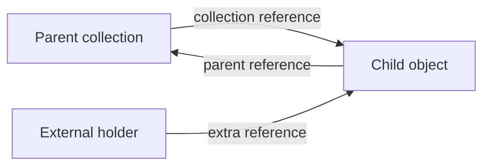

<!-- SPDX-License-Identifier: LGPL-2.1-or-later -->
# libnvme Object Lifetime Extension Proposal

Date: 2026-10-29 (Asia/Taipei), checked and updated 2026-11-19. Status: design
draft, for discussion and splitting into implementation work.
Baseline: `354b9f6f38dc`, branch `feature/host-refcount` (PR #4129).
This report proposes follow-on work; it does not claim any of the following
APIs, states, or tests are already implemented.

**2026-11-19 update**: point 1 (host use-after-free) and point 5 (the race
between a topology lookup and the final unref) from the PR #4129 review have
been implemented and merged into `feature/host-refcount` (commit
`354b9f6f3`). Scope is limited to the host object; locking only covers
`ctx->hosts`, not the subsystem/controller/namespace lists. This update also
corrected the status table in section 2 and the checkpoint list in section 3
to match; the rest (the extension design from section 4 on) is unchanged
from the original proposal and not yet implemented.

## 1. Goal and recommended order

Extend the current host-only lifetime protection to the global context,
subsystem, controller, namespace, transport handle, path, and NVMe-MI
endpoint, and fill in Python bindings, cross-platform backends, async
operations, and error paths.

Recommended order: fix the known checkpoint issues first, then settle the
ownership contract, then implement object by object. Not recommended:
turning every pointer into a strong reference first and then hunting down
cycles with tests.

Expected outcomes:

- An object with an explicit reference held on it does not become a
  dangling pointer because of a refresh, a parent's teardown, or Python GC.
- Topology removal, resource close, and memory release have distinct
  semantics.
- Existing C API borrowed/owned and free/close behavior is preserved, or any
  compatibility change is called out explicitly.
- Objects needed by in-flight I/O, completions, and callbacks have a
  traceable survival guarantee.
- Every new rule is backed by C, Python, failure-path, and threading tests.

This proposal does not equate "memory is still alive" with "the device is
still connected" or "every method can run concurrently."

## 2. Confirmed current state

Paths below are relative to the repository root and describe the baseline
commit above.

| Area | Current state and impact |
| --- | --- |
| `libnvme/src/nvme/private.h` | host has an atomic refcount and `attached`; context has an internal refcount, a topology mutex, and `destroying` (implemented; see the update below). `topology_lock` currently only protects `ctx->hosts`; subsystem/controller/namespace are still unprotected parent pointers. `libnvme_host_get_global_ctx()` returns NULL once detached (`h->ctx` itself is never cleared), which differs from this proposal's original assumption that `h->ctx` stays valid forever. |
| `libnvme/src/nvme/tree.c` | subsystem/controller/namespace destructors still recursively free children directly; each needs converting to detach/dispose plus reference release. |
| `libnvme/src/nvme/lib.c` | host now retains its context; MI endpoints are still torn down at the context's final release. Adding an endpoint→context reference will require reordering this. |
| `libnvme/src/nvme/tree.c` | a controller can exist standalone; `libnvme_unlink_ctrl()` clears `c->s`, so the current attachment point can't be treated as a permanent parent reference. |
| `libnvme/src/nvme/tree.c` | a namespace can sit on either the controller's or the subsystem's list; a controller namespace records both `c` and `s`. |
| `libnvme/src/nvme/tree.c` | a path is created by the controller and also hung off the namespace head via `nentry`; namespace teardown currently only clears the path's namespace association. |
| `libnvme/src/nvme/lib-{linux,win,freebsd}.c` | close behavior is spread across platform backends and currently frees the transport handle directly. |
| `libnvme/src/nvme/mi.c` | an endpoint's controllers list actually holds transport handles, not topology `libnvme_ctrl`s. endpoint close and a forced rescan close these handles. |
| `libnvme/src/nvme/uring.c` | a request keeps a command pointer, cookie, and user_data; closing the ring tries to drain pending completions. |
| `libnvme/libnvme3/nvme.i` | Host already takes a reference; Subsystem/Namespace destructors still don't release the C object, and Ctrl's destructor still calls free. |
| `libnvme/libnvme3/accessors.i` | the Path proxy is built by the generator; there's currently no bindings lifetime implementation matching a full refcount. |

This report is also informed by [issue #3736](https://github.com/linux-nvme/nvme-cli/issues/3736)
and [the PR #4129 review](https://github.com/linux-nvme/nvme-cli/pull/4129#issuecomment-6038015253).
Symbol naming and ABI policy the maintainers haven't settled on yet are not
treated as existing project rules.

## 3. First step: close the checkpoint gaps

The following four items should land first, as the acceptance bar before
extending to other objects:

1. Fill in GIL handling everywhere Python's scan, refresh, Subsystem, etc.
   entry points can wait on the topology mutex -- not just the paths that
   call the lock or the Host constructor directly. **Not yet implemented**:
   `libnvme_topology_lock()`/`unlock()` are currently C-only -- not exposed
   through the Python bindings and not paired with a GIL release -- so this
   deadlock risk doesn't actually occur yet. It needs to be addressed once
   the lock is exposed to Python.
2. The `-ENODEV` from a detached host creating a subsystem must become a
   Python exception at construction time; it must not produce a proxy with
   `this=None`. **Partially done**: the C-level
   `libnvme_create_subsystem()`/`libnvme_get_subsystem()` already return
   `-ENODEV` for a detached host; the Python Subsystem constructor doesn't
   yet turn that into an exception.
3. Validate that the `ctx` argument matches the object's own context; don't
   lock one context while modifying an object that belongs to another.
   Cross-context attachment should return `-EINVAL` as a rule. **Not yet
   implemented**.
4. Fix the semantics of the context-wrapper test to use a weakref to prove
   whether the Python wrapper is actually collected; verify C-side owner
   teardown with a separate C test. **Not yet implemented**.

Each item needs a test that fails before the fix and passes after. Passing
the existing suite doesn't substitute for these cases.

## 4. A unified ownership contract

### 4.1 Three kinds of relationship

| Relationship | Recommended contract |
| --- | --- |
| Lifecycle owner | Responsible for kicking off dispose; may be the creator, a Python wrapper, a cache, or a parent collection. The owner's reference must be explicitly transferable at attach time. |
| Extra strong reference | Extends the memory lifetime of the object and any necessary parent; the holder returns it with unref. Does not imply ownership of topology or device resources. |
| Borrowed/indexed | Doesn't add to the count; needs another reference or an appropriate lock for the duration of use; must be cleared or updated before the target is removed. |

The reference count tallies every real strong reference, including the
owner's and any held by a collection or an in-flight operation. Every strong
reference counts equally; "owner" only denotes responsibility for an
existing API's dispose/shutdown, not a separate kind of reference or a
second counting scheme. New APIs should not require an ordinary wrapper to
implicitly figure out whether it's the special owner.

An existing API's initial reference can't be uniformly treated as
caller-owned or uniformly as tree-owned. Before implementation, build a
table for every factory, lookup, attach, free, and close function:

| Required field | Question to answer |
| --- | --- |
| On success | Does the caller get owned, borrowed, or control of an existing owner token? |
| On successful attach | Is the reference transferred, or does it add a separate collection reference? |
| On failed attach | Which references and resources go back to the creator? |
| On remove/close | Which reference is returned? What state is left for other holders? |
| On the last unref | Has it been removed from the list, had callbacks stopped, and confirmed no pending operation? |

The same reference must not be assumed released by both the caller and the
collection. This especially matters for a standalone Ctrl attaching into
the topology, and for the difference between an MI handle produced by
endpoint scan versus a standalone open.

### 4.2 ref/unref, dispose, and finalize

- `ref()` may only be taken from a reference already held, or from a
  borrowed pointer that's valid under lock protection. It must not revive
  an object from an arbitrary raw pointer.
- `unref()` only returns the one reference the caller holds; when the last
  one disappears, it runs the applicable resource cleanup and finalize.
  Necessary dispose steps must not be skipped, but refcounting on its own
  does not break cycles.
- Dispose tears down ownership relationships: list membership, children,
  caches, callback registrations. While a reference is still held, the
  object may retain identity data for queries.
- Existing `free_*()` and `close()` keep their destructive owner-operation
  behavior; they must not simply become aliases for `unref()`. How each
  returns its old owner reference is decided per API from the table above.
- A wrapper acting as the lifecycle owner must kick off dispose and return
  the owner reference when destroyed; a wrapper that only holds an extra
  reference should just unref. In particular, the GlobalCtx destructor must
  not become a plain unref, or a parent/child cycle may never reach
  dispose.

Adding an owned lookup/iterator can avoid the need to change the meaning of
old borrowed APIs. Names below are conceptual placeholders; this proposal
does not commit to any new exported symbol.

### 4.3 Handling reference cycles

A parent collection holding a child, and the child holding the parent back,
forms a real reference cycle. This design relies on the owner's explicit
dispose to break it; it does not claim refcounting resolves cycles on its
own.



Dispose must clear the collection and its reference first; while the child
is still externally held, it may keep the parent's necessary memory alive.
The child's finalize then returns the parent reference last. The concrete
parent object doesn't necessarily equal its collection container directly;
the diagram above is only illustrating the two-way ownership problem.

## 5. Recommended model per object type

| Object | Strong references needed to stay alive | List/other relationships | Allowed behavior after dispose |
| --- | --- | --- | --- |
| Global context | root owner, plus host, standalone ctrl/ns, handle, endpoint, and other necessary holders | owns management responsibility for hosts/endpoints | rejects creating new children and new I/O; still keeps whatever memory existing object cleanup needs. |
| Host | context | managed by the hosts collection while attached | keeps its identity, child collections cleared; new attachment returns an error. |
| Subsystem | host | managed by the host while attached | keeps identity data, controller/namespace child collections cleared. |
| Controller | context; also retains the necessary subsystem while attached | supports standalone creation plus unlink/reparent; paths, namespaces, and the handle each have explicit, separate ownership | old object remains queryable, resource operations rejected based on state; unlink and free are not conflated. |
| Namespace | context; while it exists, retains a valid reference on both controller and subsystem | controller namespaces and subsystem namespaces are different management paths | keeps identity data already obtained; stops reading from invalid sysfs or a closed handle. |
| Path | retains at least the original controller; may also retain the context for synchronization scope | controller paths are the primary management path; namespace head paths should only be a non-owning index | clears the namespace association; controller membership required by the public API is expressed separately from the historical parent. |
| Transport handle | context; an MI handle also retains the endpoint | owner/reference bookkeeping for the cache, the caller, and the endpoint list is registered per entry point | safe to unref/query state after CLOSED; does not imply I/O is still possible. |
| MI endpoint | context | managed by the context's endpoints; the "controllers" list is actually a handle list | stops new commands and AEM, tears down handle management relationships, closes transport resources; freed only on the last reference. |

### 5.1 Controller unlink and reparenting

`libnvme_unlink_ctrl()` currently sets `c->s` to NULL; this observable
behavior must be preserved. A public getter must not keep reporting "still
attached" just to extend the parent's lifetime.

Recommendation: distinguish current membership from the parent reference
held. Where the historical parent needs to be kept, use a private field
rather than reusing the field that's expected to be cleared on unlink.
Reparenting should happen under the same context's topology lock: take the
new reference first, update the relationship, then return the old
reference. Cross-context transfer is not a first-version feature.

If the controller already has namespaces/paths, detach or update those
children before reparenting. Don't assume `n->s` is still valid just
because `c->s` has changed.

### 5.2 Namespace and path's multiple associations

A namespace's `c` and `s` may both exist at once; recommend each keeps its
own necessary parent reference rather than relying only on the indirect
`c->s` relationship. That way, when a controller is reparented, an old
namespace doesn't silently end up pointing at a different subsystem, nor
left with a stale pointer because its old parent was freed.

A path's `entry` and `nentry` don't represent two owner references.
Recommendation: the controller owns primary membership, and the namespace
head list is a removable index. `p->n` is a lock-protected weak
association: before namespace dispose, remove `nentry` and clear `p->n`
first. A caller needing the namespace across locks should get a reference
through an owned accessor.

`libnvme_ns_head` keeps namespace-owned aggregate data for now: an
operation borrowing the head must also retain the namespace. Only add a
separate refcount once it's confirmed the head must survive independently.
Attributes, strings, and stat buffers stay managed by their owning object;
don't add refcounting to each of them individually.

### 5.3 Getters on a detached object

Not every getter can be promised to work correctly after detach. Some
getters lazy-load sysfs, access the parent, or reopen a handle.

Getters need to be audited into three categories: those that can return
already-owned data, those that can return a retained parent, and those that
need a live device resource. The last category should return an existing
error form in the detached/closed state. For old string getters that can't
represent an errno, keep their existing NULL/default-value contract rather
than changing the function signature arbitrarily. A separate owned/copy API
that can return an error may be added later, pending upstream agreement.

A refcount guarantees the object's memory stays alive; it does not
guarantee an internal mutable string stays valid after a concurrent setter.
A caller needing a string across locks should copy the data or use a
snapshot/copy API.

## 6. Transport and NVMe-MI resource semantics

### 6.1 Separate object state from resource state

Topology membership and the transport's OPEN/CLOSING/CLOSED state are two
different dimensions. Detach must not quietly become an NVMe-oF disconnect;
holding a reference also must not block an explicit close. Ctrl's existing
context-manager disconnect behavior needs to be kept and tested separately.

Recommend separating plain resource close from reference release: a new
close-resources interface blocks new operations, handles pending
operations, and invalidates the resource, without consuming the caller's
reference. Existing close/free compatibility entry points additionally
return the reference they're responsible for, under their old contract;
GIO's close contract must not be applied directly to the old
`libnvme_close()`. An extra reference may keep a CLOSED object around.
`libnvme_close()` must not simply become "only close the fd on the last
unref" -- that would change the semantics of release-fds, endpoint close,
and error cleanup.

Controller/namespace's cached handle getter stays borrowed for now; add an
owned way to get it for cross-lock use. Clearing the cache needs to
separate "close the resource" from "drop the cache's reference." The
endpoint handle list's, the cache's, and the caller's shares must not be
returned twice by the same close. This is one of the API ownership tables
that must be completed before implementation.

### 6.2 Pending I/O and callbacks

Every accepted sync or async operation holds at least enough handle
reference to cover its completion path. An MI handle retains the endpoint,
the endpoint retains the context; an independently registrable AEM callback
also needs its own lifetime guarantee.

Accepting a request:

1. Confirm OPEN under the resource-state lock, and take an operation
   reference / increment the active-operation count.
2. Release the topology lock, then do the potentially blocking ioctl,
   network, or io_uring work.
3. The completion/cancel path returns exactly one operation reference.

Close must define draining, canceling, or deferring the actual close; it
must not free an fd, request, or buffer while the kernel or a completion
might still use it. Triggering a close from inside a callback must not
synchronously wait for that same callback to finish; the concrete deferred-
close mechanism is settled at the transport stage.

A handle reference does not automatically extend the caller's command
buffer, cookie, user_data, or a Python callback payload's lifetime. Copy,
retain/release, or "valid until completion" must be an explicit agreement
with the caller. A partial initialization failure must also not leak a
context/endpoint reference already taken.

### 6.3 MI's special cycle

Once endpoint→context and handle→endpoint strong references are added, the
existing context→endpoint list and endpoint→handle list can form a cycle.

So `free_global_ctx()` must actively close/detach endpoints during the
owner's dispose phase, rather than waiting for the context's refcount to
hit zero before starting endpoint cleanup -- otherwise the context may
never reach zero. Endpoint dispose likewise first blocks new commands,
tears down handle management relationships, then returns references.

MI handles currently come from standalone init, endpoint scan, and `mctp:`
open; the owner transfer for each path needs checking individually -- don't
infer which reference a close should consume just because the handle
appears on the controllers list. A forced rescan must safely invalidate the
old handle before building the new list, rather than directly freeing an
old handle an external caller still holds.

## 7. Synchronization model

Recommend starting with a single per-context topology mutex managing
membership, lookup/ref, attach/detach, and mutable parent relationships.
Each handle/endpoint separately manages its own resource state and pending
I/O. Avoid adding multiple locks per object type from the start, before
lock ordering can be proven.

- An owned lookup's search, liveness check, and ref must happen in the same
  critical section.
- On removal, tear down the index under the lock first, so a lookup can't
  find an object that's about to be freed.
- Move the last unref that might trigger a destructor, an fd close, or a
  callback outside the lock where possible: collect pending references
  under the lock, release them outside it, while keeping whatever context
  operation pin is necessary.
- Initial lock order is topology → endpoint state → handle state; acquiring
  them in reverse order is forbidden. If a completion needs the topology
  lock, release the resource lock first, then reacquire in the required
  order and re-validate state.
- The topology lock must never span blocking I/O, waiting on another
  thread, or an arbitrary user callback. After an operation returns,
  reacquire the lock, validate generation and parent/membership, and only
  then update the topology.
- `libnvmf_add_ctrl()` currently wraps the entire connect inside the
  topology lock; this needs splitting into prepare / do the I/O / verify
  and attach, rather than spreading the existing coarse lock across every
  operation.

Atomic counters don't replace the locks above. The refcount's initial
value, last release, prohibition on reviving a freed object, under/overflow
behavior, and diagnostics policy need to be decided centrally; a small
number of private helpers may be reused, but don't introduce a general
object framework up front.

## 8. Python bindings

1. Every independently-survivable wrapper maps to one explicit C reference,
   not just `__parent`.
2. Every return path of a constructor, lookup, iterator, `__enter__`, and
   parent getter is marked borrowed/owned; two wrappers must never consume
   the same reference.
3. Use SWIG ownership declarations to build an owned proxy; don't simulate
   taking ownership by flipping an existing borrowed proxy's
   `thisown=True`.
4. An iterator takes an owned snapshot under the lock, then yields outside
   it. The snapshot guarantees the members' memory, not that every
   attribute is an immutable value frozen at the same instant; build a
   separate data snapshot if that's needed.
5. Audit the GIL at every entry point that can wait on a C lock or block on
   I/O: keep the Python arguments and any necessary C reference, then
   release the GIL; reacquire it before turning an error into an
   exception.
6. A cross-context argument, an operation on a closed/detached object, or a
   constructor failure must raise a clear exception immediately.
7. A pure-reference wrapper's destructor should just unref; an owner
   wrapper kicks off dispose per section 4. For a standalone Ctrl created
   then attached, the owner must be explicitly transferred while the
   wrapper keeps its own reference.
8. Path needs a proper destructor and an owned accessor added. New or
   fuller Python classes for MI endpoint/handle should wait until the C
   model stabilizes; don't assume complete bindings already exist.

Implementation needs to test, together: multiple proxies pointing at the
same C object, module shutdown, GC cycles, a generator closed early,
constructor exceptions, and user subclasses. Diagnostic frames must not
create an extra GC cycle.

## 9. ABI, platforms, and diagnostics

Public APIs should keep their existing signatures and borrowed semantics
where possible; an owned interface is added as something new where
necessary. `_at()` suffixes or double-underscore backing symbols, a public
lock, and a new version node are upstream's call.
The checkpoint originally chose to put the new symbols in their own
`LIBNVME_3.1` version node; the version merged into `feature/host-refcount`
instead added them directly to the existing `LIBNVME_3`, without opening a
new version node. Which of the two is the ABI convention upstream actually
wants is still unconfirmed, and neither is treated as an accepted release
policy.

Opaque structs may gain new private state; all accessor/bindings generated
files are updated by the generator. Management fields like counters, locks,
and owner/state are not auto-exported as public setters. Shared and
fabrics/MI-specific APIs keep their own build gates and linker symbol
groupings.

Close behavior, failure cleanup, and threading dependencies on Linux,
Windows, and FreeBSD all need checking; MI and io_uring use whatever
platform/feature configuration is available on each -- don't drop them just
to pass a minimal build.

ref/unref diagnostics keep using an independent switch, logging the object
class, a stable instance identifier, the operation, the resulting count,
and the call site. The instance identifier should avoid relying solely on
an address that may be reused; it must not print keys or device-private
content. The switch is read once; the diagnostic itself must not hold an
object, cause recursion, or introduce a lock-order inversion.

## 10. Staged delivery and acceptance

| Stage | Deliverable | Acceptance bar |
| --- | --- | --- |
| 0 | Fix the four checkpoint issues from section 3 (note: these four are different from point 1/5 of the PR #4129 review -- point 1/5 are already fixed and merged into `feature/host-refcount`; the four items in section 3 are still pending) | A failing-first test for each; the existing host suite and the GIL-timeout case pass. |
| 1 | API ownership table, context dispose, shared ref/state rules | Confirm owner transfer and cycle-breaking; no leak on any error branch; no unnecessary public framework added. |
| 2 | Subsystem, Ctrl, Namespace, and the existing Python classes | Parent disposes first, any wrapper release order, unlink/reparent, old objects stay safe after a refresh. |
| 3 | Path, namespace head indexing, and multipath | Both removal orders, controller deletion, namespace replacement, a rescan with no duplicate index or stale pointer. |
| 4 | Handle, MI endpoint, pending operations, and necessary bindings | close/rescan for direct/MI/loopback/privsep; I/O vs. close races; a resource closed exactly once. |
| 5 | Full audit, ABI, and cross-platform integration | Every removal and lookup entry point follows a consistent contract; generated files, symbols, docs, and platform builds all check out. |

Each stage includes implementation, bindings, docs, and tests -- don't
leave all testing for the end. Every submittable change should build
independently; organize the current fix-type commits into a reviewable
series -- but rebasing, squashing, committing, or pushing is not part of
what this report covers.

### Required test matrix

| Aspect | Cases |
| --- | --- |
| Reference | create, repeated lookup, two or more external references, final release, owner transfer and failure rollback. |
| Parent | release the root owner first, release the child first, interleaved release of sibling objects, an old parent replaced by a new one. |
| Topology | refresh, delete, unlink, reparent, cross-context rejection, an old pointer not affecting the new tree. |
| Python | owned/borrowed returns, GC, module shutdown, weakref, context manager, an iterator stopped early and exceptions. |
| Concurrency | lookup/ref vs. detach, scan vs. iteration, the final unref, GIL vs. mutex, I/O completion vs. close. |
| Resources | repeated fd/socket close, pending cancel/drain, AEM callback, partial init failure, close from inside a callback. |
| Features | fabrics on/off, MI on/off, io_uring on/off, Python on/off, and each supported OS. |

Tests should mainly use fake sysfs, loopback, and MI/MCTP mocks -- don't
assume a real SSD is available. Use ASan/UBSan and C leak detection for
lifetime and resource cases; Python's known runtime leaks need separating
baseline noise from project leaks -- turning off LeakSanitizer is not
evidence of no leaks. Use ThreadSanitizer (where the environment supports
it) plus deterministic barrier/condition cases for key races -- running a
large number of ref/unref pairs, or relying on sleep, is not grounds to
claim full thread safety.

## 11. Scale, risk, and decisions still needed

Starting from the current checkpoint, a rough initial estimate for the full
scope is a net increase of about 2,000-4,000 lines, not counting generated
files; this is not a ceiling or a commitment. Tests may account for roughly
half of that. If pending I/O, callbacks, and old C API compatibility need
new adapters, the scope may grow -- re-estimate after the ownership table
and the MI/resource prototype are done.

Main risks:

- An owner reference and an extra reference transferred incorrectly,
  causing a missed release or a double release.
- Context/endpoint dispose happening too late, forming a cycle that never
  reaches zero.
- Only extending memory lifetime while an already-closed fd, sysfs entry,
  or callback keeps being used.
- Reverse waiting between the topology lock, a resource mutex, and the
  GIL.
- Changing a borrowed API's, Ctrl reparenting's, endpoint force-rescan's, or
  release-fds' old semantics.
- Only validating in a fabrics-disabled or MI-disabled configuration,
  missing the main integration paths.

Decisions needed before implementation:

1. Is explicit owner dispose accepted as the way to break cycles, kept
   separate from extra ref/unref?
2. Does the owner-and-transfer table for every existing factory/free/close
   match the existing C users?
3. Which getters, reparenting, and resource operations are allowed on a
   detached object?
4. Is the topology lock public, or hidden behind an owned lookup/iterator?
   The host scope has already chosen to make it public
   (`libnvme_topology_lock()`/`unlock()`, a recursive mutex); whether
   extending to other objects reuses the same lock or the same decision is
   still unconfirmed.
5. Backing symbol naming and ABI version node policy.
6. The completion/deferred-close contract for pending I/O and close from
   inside a callback.
7. Does a public Python class for MI endpoint/handle ship in the same batch
   as the C lifetime extension?

Recommend getting upstream agreement on the ownership and close contracts
from sections 4-8 before starting stage 1 implementation. The known
correctness fixes in stage 0 can be done independently, without waiting for
every extension API to be settled.

## 12. Comparison with GLib, GObject, and GIO

This section checks the design principles against the official docs, and
separates the current checkpoint from what's still just proposed. Adopting
these principles doesn't mean turning libnvme's types into GObjects or
adding a GLib runtime dependency.

### 12.1 Comparison table

| Topic | Official model | Checkpoint state | This proposal's direction |
| --- | --- | --- | --- |
| Reference | GObject unref returns one strong reference; hitting zero starts final release. | host and the internal context already use atomic counts; other types aren't consistent yet. | Unify the acquire/return contract per object class; a counting helper can be shared, without introducing a second, owner-specific counting scheme. |
| Relationship cleanup | GObject dispose returns references to other objects, and must handle being called more than once; finalize does the last cleanup. | free_host detaches and clears children, still keeps the context; only the final host destructor returns the context. | Define topology detach, resource close, relationship dispose, and finalize separately; don't claim they're the same just because both have two functions. |
| Container destroy | GHashTable destroy clears elements then unrefs; unref only does final cleanup at zero. | free_host clears the subtree and drops the tree reference; host_unref returns the external reference. | free_host's compatibility semantics are closer to a container destroy than to a typical GObject unref. |
| Resource close | GInputStream close closes the stream without returning the caller's reference; it can still be unreffed. | libnvme_close closes the resource and frees the handle; there's no CLOSED handle that can be retained. | A new interface separates close from unref; the old API goes through a compatibility entry point; explicitly forbid continuing to use a closed resource while holding a reference. |
| Cycles | A plain refcount doesn't resolve a strong reference cycle on its own; run_dispose lets an object system break cycles. | host and context rely on free_global_ctx explicitly tearing down the hosts list. | Prefer reducing unnecessary two-way strong relationships; list shutdown entry points for any necessary cycle individually. Don't treat run_dispose as a general-purpose fix any caller can reach for. |
| Weak reference | GWeakRef can synchronously upgrade a still-valid weak relationship into a strong reference. | raw pointers like path→namespace have no such general mechanism; cleanup still relies on list removal. | A weak pointer is looked up, ref'd, and invalidated under the same lock; never ref a raw pointer directly after unlocking. |
| Thread safety | GLib clearly separates a refcount's thread safety from synchronizing a container's contents. | host's topology operations already have a lock (a recursive mutex), but the scope doesn't cover subsystem/controller/namespace; the lock isn't exposed to Python and isn't paired with a GIL release, so there's no deadlock yet -- but it must be added once it is exposed. | A refcount helper shouldn't take on field-level locking; fill in entry points, lock ordering, and staged handling of blocking operations. |
| Bindings | transfer none/full and similar annotations clearly state whether a reference is being transferred. | SWIG handles this per-type with its own constructor, destructor, newobject, and parent attribute. | Build a consistent borrowed/owned table for every return path, then map it onto SWIG; don't let a Python parent attribute stand in for C ownership. |

Sources:
[GObject unref](https://docs.gtk.org/gobject/method.Object.unref.html),
[dispose](https://docs.gtk.org/gobject/vfunc.Object.dispose.html),
[run_dispose](https://docs.gtk.org/gobject/method.Object.run_dispose.html),
[HashTable destroy](https://docs.gtk.org/glib/type_func.HashTable.destroy.html),
[HashTable unref](https://docs.gtk.org/glib/type_func.HashTable.unref.html),
[InputStream close](https://docs.gtk.org/gio/method.InputStream.close.html),
[GWeakRef get](https://docs.gtk.org/gobject/method.WeakRef.get.html),
[Threads](https://docs.gtk.org/glib/threads.html),
[transfer annotations](https://gi.readthedocs.io/en/latest/annotations/giannotations.html).

### 12.2 Two lifetimes that can't be equated directly

GObject's typical final-unref path can be summarized as: return the
reference, run dispose, then finalize; the details include reentrancy and
retaking a reference, and can't be copied mechanically onto every type as a
single flow. Its dispose returns references to other objects.

The current host path is:

```text
free_host(host)
  -> detach + clear subsystems + return the tree reference
  -> if still externally held: host keeps its context reference

finally host_unref(host)
  -> release the host's own data + return the context reference
```

Keeping the context is a lifetime guarantee this project chose to make; it
is not GObject requiring every child to strongly hold its parent. If
free_host were renamed to a full dispose, it would need to explain why it
still keeps the parent reference; the detach/clear naming describes the
current behavior more accurately.

Also, GObject having dispose doesn't mean a two-way reference recovers
itself automatically. When neither side's count reaches zero, the typical
final-unref path never runs; an explicit shutdown or an appropriate weak
relationship is still required. The official run_dispose is scoped to
object-system implementations, not a requirement that every wrapper
actively tear down a shared object on destruction.

### 12.3 What to adopt and what to avoid

Recommend adopting:

1. Let every wrapper/collection/in-flight operation each hold one explicit
   strong reference.
2. Write the owned-vs-borrowed distinction into the API contract, not
   implied by a function's name or the calling context.
3. Separate resource close from unref, so "retained but closed" becomes a
   testable state.
4. Use a weak relationship for an index that doesn't need to keep its
   target alive, and protect its invalidation and its promotion to a
   strong reference.
5. Design relationship teardown to be reentrant/idempotent on repeated
   calls, without returning the same reference twice -- this does not mean
   an already-freed pointer can be used again.

Recommend avoiding, directly:

- Building a separate implicit rule set around a "special owner
  reference." Keep existing free/close responsibilities in the
  compatibility layer; a new API should let an ordinary wrapper work with
  a fixed reference contract.
- Adding a strong reference to every parent or associated pointer
  unconditionally. Section 5 is just one candidate model that needs
  validating edge by edge, not a GLib requirement; a field already
  guaranteed by an existing strong relationship can stay borrowed.
- Floating references. GObject's own docs no longer recommend them for
  modern code, especially since they add ownership ambiguity to bindings.
  This project should prefer an explicit transfer contract instead.
- Claiming weak pointers or topology synchronization are done just because
  an atomic counter was added.

GLib also offers an atomic reference-counted box, showing that simple C
data can use a lightweight count/cleanup mechanism without adopting the
full GObject type system. That mechanism itself, though, doesn't provide a
safe concurrent weak reference either; libnvme still has to define its own
lookup, indexing, and locking.

References: [floating references](https://docs.gtk.org/gobject/floating-refs.html),
[atomic box acquire](https://docs.gtk.org/glib/func.atomic_rc_box_acquire.html),
[atomic box release](https://docs.gtk.org/glib/func.atomic_rc_box_release_full.html).
