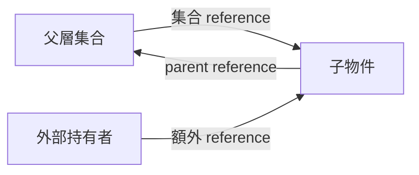

<!-- SPDX-License-Identifier: LGPL-2.1-or-later -->
# libnvme 物件生命週期擴展提案

日期：2026-10-29（Asia/Taipei）。狀態：設計草案，供討論與拆分實作。
基準：`4438301365a1efe21e23bfcdbf3d39d3bc2203bb`，分支 `feature/host-refcount`。
本報告提出後續方案，不表示以下 API、狀態或測試已實作完成。

## 1. 目標與建議順序

將目前 host-only 的生命週期保護，擴展至 global context、subsystem、
controller、namespace、transport handle、path 與 NVMe-MI endpoint，
並補齊 Python bindings、跨平台後端、非同步操作與錯誤路徑。

建議先修正 checkpoint 的已知問題，再確定 ownership 契約，最後分物件落實。
不建議先把所有指標改成強 reference，再以測試找出循環。

預期成果：

- 明確持有 reference 的物件，不因 refresh、父物件 teardown 或 Python GC
  變成 dangling pointer。
- topology 移除、資源關閉與記憶體釋放有不同語意。
- 保留既有 C API 的 borrowed/owned 與 free/close 行為，或明確提出相容性變更。
- 正在執行的 I/O、completion 與 callback 所需物件有可追蹤的存活保證。
- 所有新增規則都有 C、Python、失敗路徑及執行緒測試支持。

本提案不把「記憶體仍存活」等同於「裝置仍連線」或「所有方法可任意並行」。

## 2. 已確認的現況

以下路徑均相對 repository root，描述上述基準版本。

| 區域 | 現況與影響 |
| --- | --- |
| `libnvme/src/nvme/private.h` | host 有 atomic refcount、attached；context 有內部 refcount、topology mutex、destroying。其他物件仍有未受保護的 parent 指標。 |
| `libnvme/src/nvme/tree.c` | subsystem/controller/namespace 的 destructor 仍直接遞迴釋放子項目；需逐項改為 detach/dispose 與 reference release。 |
| `libnvme/src/nvme/lib.c` | host 已保留 context；MI endpoints 目前仍在 context 最終釋放時清除。加入 endpoint→context reference 後必須改動此順序。 |
| `libnvme/src/nvme/tree.c` | controller 可獨立存在；`libnvme_unlink_ctrl()` 會清除 `c->s`，不能把目前掛接位置直接當成永久 parent reference。 |
| `libnvme/src/nvme/tree.c` | namespace 可位於 controller 或 subsystem 清單；controller namespace 同時記錄 `c`、`s`。 |
| `libnvme/src/nvme/tree.c` | path 由 controller 建立，另透過 `nentry` 掛入 namespace head；namespace 銷毀目前只解除 path 的 namespace 關聯。 |
| `libnvme/src/nvme/lib-{linux,win,freebsd}.c` | close 行為分散在平台後端，且目前會直接 free transport handle。 |
| `libnvme/src/nvme/mi.c` | endpoint 的 controllers 清單存放的是 transport handle，不是 topology 的 `libnvme_ctrl`。endpoint close 與 force rescan 會關閉這些 handle。 |
| `libnvme/src/nvme/uring.c` | request 保留 command 指標、cookie 與 user_data；關閉 ring 會嘗試 drain pending completions。 |
| `libnvme/libnvme3/nvme.i` | Host 已取 reference；Subsystem/Namespace destructor 仍不釋放 C 物件，Ctrl destructor 仍呼叫 free。 |
| `libnvme/libnvme3/accessors.i` | Path proxy 由產生器建立；目前沒有與完整 refcount 對應的 bindings 生命週期實作。 |

報告依據也包含 [issue #3736](https://github.com/linux-nvme/nvme-cli/issues/3736)
與 [PR #4129 的審查](https://github.com/linux-nvme/nvme-cli/pull/4129#issuecomment-6038015253)。
維護者尚未定案的符號命名與 ABI 策略，不視為既有專案規則。

## 3. 第一步：先補 checkpoint 的缺口

以下四項先完成，作為擴展其他物件前的驗收門檻：

1. 補齊 Python scan、refresh、Subsystem 等入口等待 topology mutex 時的
   GIL 處理；不只修直接呼叫 lock 或 Host constructor 的路徑。
2. detached host 建立 subsystem 的 `-ENODEV` 必須在建構時轉成 Python
   例外，不得產生 `this=None` 的無效 proxy。
3. 驗證參數 `ctx` 與物件所屬 context 一致；不得鎖住另一個 context
   卻修改目前物件。跨 context 掛接原則上回傳 `-EINVAL`。
4. 更正 context-wrapper 測試的語意，使用 weakref 證明 Python wrapper
   是否真的被回收；C owner teardown 由獨立 C 測試驗證。

每項必須有修正前失敗、修正後成功的測試。既有 suite 通過不能替代這些案例。

## 4. 統一所有權契約

### 4.1 三種關係

| 關係 | 建議契約 |
| --- | --- |
| 生命週期 owner | 負責啟動 dispose，可能是建立者、Python wrapper、cache 或父層集合。owner 的 reference 必須能在掛接時明確移交。 |
| 額外強 reference | 延長物件與必要 parent 的記憶體生命週期，持有者以 unref 交還；不代表擁有 topology 或裝置資源。 |
| 借用／索引 | 不增加計數，使用期間需有其他 reference 或適當鎖保證；移除目標前必須清除或更新關聯。 |

reference count 計算所有實際強 reference，包括 owner、集合或進行中操作
持有的份數。每份強 reference 在計數上平等；owner 只表示既有 API 的
dispose/shutdown 責任，不是另一類 reference，也不是另一套計數。
新 API 不應要求一般 wrapper 隱含判斷自己是否是特殊 owner。

既有 API 的初始 reference 不能一律當成 caller-owned，也不能一律當成
tree-owned。實作前先為每個 factory、lookup、attach、free、close 建立表格：

| 必填項目 | 要回答的問題 |
| --- | --- |
| 成功回傳 | caller 得到 owned、borrowed，還是既有 owner token 的控制權？ |
| 掛接成功 | reference 是移交，還是另外新增一份集合 reference？ |
| 掛接失敗 | 哪些 reference 與資源退回建立者？ |
| 移除／關閉 | 交還哪一份 reference？其他持有者剩下什麼狀態？ |
| 最後一次 unref | 是否已解除清單、停止 callback，且沒有 pending operation？ |

同一份 reference 不得同時被呼叫者與集合認為由自己釋放。特別是獨立 Ctrl
掛入 topology，以及 MI handle 由 endpoint 掃描或獨立 open 產生的差異。

### 4.2 ref/unref、dispose 與 finalize

- `ref()` 只能從已持有的 reference，或鎖保護下的有效借用指標取得。
  不從任意 raw pointer 復活物件。
- `unref()` 只交還呼叫者持有的那一份；最後一份消失時完成適用的資源清理
  與 finalize。必要的 dispose 不能漏掉，但 refcount 本身不會打破循環。
- dispose 解除清單、子項目、cache、callback 註冊等所有權關係。
  在仍有 reference 時，物件可以保留身分資料供查詢。
- 既有 `free_*()` 與 `close()` 維持其破壞性 owner 操作，不能直接改成
  `unref()` 的別名。它們如何交還舊 owner reference，按上表逐個 API 決定。
- 正在作為生命週期 owner 的 wrapper，銷毀時需要啟動 dispose 並交還 owner
  reference；純粹持有額外 reference 的 wrapper 才只做 unref。
  尤其 GlobalCtx destructor 不能直接換成普通 unref，否則 parent/child 循環
  可能永遠不會走到 dispose。

新增 owned lookup/iterator 可避免修改舊 borrowed API 的意義。
其名稱先用概念表示，不在本提案中承諾任何新匯出符號。

### 4.3 循環 reference 的處理

父層集合保留 child，child 又保留 parent，會構成真實的 reference cycle。
此方案依賴 owner 的顯式 dispose 拆開循環，不宣稱 refcount 能自行回收循環。



dispose 必須先清除集合及其 reference；child 仍由外部持有時，可繼續保留
parent 的必要記憶體。最後 child finalize 再交還 parent reference。
具體 parent 物件不一定直接等於其集合容器；以上圖只表達雙向所有權問題。

## 5. 各類物件的建議模型

| 物件 | 存活所需強 reference | 清單／其他關係 | dispose 後允許的行為 |
| --- | --- | --- | --- |
| Global context | root owner，加上 host、獨立 ctrl/ns、handle、endpoint 等必要持有者 | 擁有 hosts/endpoints 的管理責任 | 拒絕建立新子物件及新 I/O；仍可維持既有物件清理所需記憶體。 |
| Host | context | attached 時受 hosts 集合管理 | 保留身分，子集合清空；新掛接回傳錯誤。 |
| Subsystem | host | attached 時受 host 管理 | 保留識別資料，controller/namespace 子集合清空。 |
| Controller | context；掛接期間另保留必要 subsystem | 支援獨立建立及 unlink/reparent；paths、namespaces、handle 有各自明確所有權 | 舊物件可查詢，資源操作依狀態拒絕；unlink 與 free 不混為一談。 |
| Namespace | context；存在時保留 controller 與 subsystem 的有效 reference | controller namespace 與 subsystem namespace 是不同管理路徑 | 保留已取得的識別資料；不再從無效 sysfs 或已關閉 handle 讀取。 |
| Path | 至少保留原 controller；可另外保留 context 以取得同步範圍 | controller paths 為主要管理路徑；namespace head paths 建議只作非 owning 索引 | 清除 namespace association；公開 API 所要求的 controller membership 與歷史 parent 分開表達。 |
| Transport handle | context；MI handle 另保留 endpoint | cache、caller、endpoint 清單的 owner/reference 逐入口登記 | CLOSED 後仍可安全 unref／查詢狀態；不代表仍可 I/O。 |
| MI endpoint | context | context endpoints 管理；controllers 清單其實是 handle 清單 | 停止新命令與 AEM、解除 handles、關閉傳輸資源；最後 reference 才 free。 |

### 5.1 Controller 的 unlink 與重新掛接

目前 `libnvme_unlink_ctrl()` 將 `c->s` 設為 NULL，這個可觀察行為須保留。
不能為延長 parent 生命週期，讓公開 getter 繼續回傳「仍掛接」的假象。

建議區分目前 membership 與持有的 parent reference。需要保留歷史 parent
時，使用 private 欄位，不沿用要求在 unlink 後清空的欄位。
重新掛接要在同一個 context 的 topology 鎖下完成，先取得新 reference，
更新關係，再交還舊 reference。跨 context 移轉不列為初版支援功能。

若 controller 原有 namespace/path，reparent 前先 detach 或更新這些子物件。
不能改完 `c->s` 就假設 `n->s` 仍有效。

### 5.2 Namespace 與 path 的多重關聯

namespace 的 `c` 與 `s` 可能同時存在；建議各自保留必要的 parent reference，
不只依靠 `c->s` 的間接關係。如此 controller reparent 時，舊 namespace 不會
無聲地指向另一個 subsystem，也不會因舊 parent 被釋放而留下 stale pointer。

path 的 `entry` 與 `nentry` 不代表兩份 owner reference。
建議 controller 擁有主要 membership，namespace head 清單是可拆除的索引。
`p->n` 為鎖保護下的弱關聯；namespace dispose 前，先移除 `nentry` 並清空
`p->n`。需要跨鎖使用 namespace 的呼叫者，透過 owned accessor 取得 reference。

`libnvme_ns_head` 暫時維持 namespace 擁有的聚合資料：借用 head 的操作必須
同時保留 namespace。只有確認 head 必須獨立存活時，才另加 refcount。
attributes、字串、統計 buffer 仍由所屬物件管理，不逐一加入 refcount。

### 5.3 Detached 物件的 getter

不能承諾每個 getter 都可在 detach 後正常讀取。部分 getter 會 lazy-load
sysfs、存取 parent 或重新開啟 handle。

需將 getter 分成：可回傳已擁有資料、可回傳保留的 parent、需存活裝置資源，
三類逐一稽核。最後一類在 detached/closed 狀態回傳既有錯誤形式。
對不能表示 errno 的舊字串 getter，採其既有 NULL/預設值契約，不能任意
改變函式簽章。可另外增加會回傳錯誤的 owned/copy API，待上游同意。

refcount 保證物件記憶體存活，並不保證內部可變字串在並行 setter 後仍有效。
需要跨鎖使用字串的呼叫者應複製資料或使用 snapshot/copy API。

## 6. Transport 與 NVMe-MI 的資源語意

### 6.1 物件狀態與資源狀態分開

topology 的 membership 與 transport 的 OPEN/CLOSING/CLOSED 是兩個維度。
detach 不應悄悄變成 NVMe-oF disconnect；保留 reference 也不應阻止明確的 close。
既有 Ctrl context-manager 的 disconnect 行為需單獨保留及測試。

建議將純資源關閉與 reference release 分開：新 close-resources 介面阻止
新操作、處理 pending operation 並使資源失效，不消耗 caller reference。
既有 close/free 相容入口則依舊契約額外交還其負責的 reference；不能直接
將 GIO 的 close 契約套到舊 `libnvme_close()`。額外 reference 可保留 CLOSED 物件。
不能僅把現有 `libnvme_close()` 改成「最後一次 unref 才關 fd」，否則
release-fds、endpoint close 與錯誤清理會改變語意。

controller/namespace 的 cached handle getter 先維持 borrowed；新增 owned
取得方式供跨鎖使用。清除 cache 時需分開「關閉資源」與「放掉 cache reference」。
endpoint handle 清單、cache 與 caller 的份數不得由同一個 close 重複交還。
這是實作前必須完成的 API ownership 表格之一。

### 6.2 Pending I/O 與 callback

每個已接受的同步／非同步操作，至少持有足以覆蓋完成路徑的 handle reference。
MI handle 保留 endpoint，endpoint 保留 context；若有可獨立註冊的 AEM callback，
其註冊也要有獨立 lifetime 保證。

接單流程：

1. 在資源狀態鎖下確認 OPEN，取得 operation reference／active-operation 計數。
2. 離開 topology 鎖，執行可能阻塞的 ioctl、網路或 io_uring 工作。
3. completion/cancel 路徑恰好交還一次 operation reference。

close 必須定義 drain、cancel 或延後實體關閉，不能在 kernel 或 completion
仍可能使用 fd、request、buffer 時釋放它們。callback 內觸發 close 時，
不得同步等待該 callback 自己完成；具體延後關閉機制在 transport 階段定案。

handle reference 不會自動延長 caller 的 command buffer、cookie、user_data
或 Python callback payload。須明確約定 copy、retain/release 或 completion 前
由 caller 保持有效。部分初始化失敗也不能漏掉已取得的 context/endpoint reference。

### 6.3 MI 的特殊循環

加入 endpoint→context 與 handle→endpoint 強 reference 後，原本的
context→endpoint 清單與 endpoint→handle 清單可能構成循環。

因此 `free_global_ctx()` 必須在 owner dispose 階段主動關閉／detach endpoints，
而非等 context refcount 歸零才進入 endpoint 清理。否則 context 永遠不會歸零。
endpoint dispose 同樣先阻止新命令，拆除 handle 管理關係，再交還引用。

目前 MI handle 來源包含獨立 init、endpoint scan 與 `mctp:` open；
各路徑的 owner 移交須逐一核對，不能只依 handle 出現在 controllers 清單
就推論 close 應消耗哪一份 reference。force rescan 必須使舊 handle 安全地
進入失效狀態，再建立新清單，不能直接 free 外部仍持有的舊 handle。

## 7. 同步模型

建議初期使用一把 context topology mutex 管理 membership、lookup/ref、
attach/detach 與可變 parent 關係。各 handle/endpoint 另管理資源狀態與 pending I/O。
避免一開始加入每物件多把鎖而無法證明鎖順序。

- owned lookup 的搜尋、存活判定及 ref 必須在同一個 critical section。
- 移除時先在鎖下拆除索引，避免 lookup 找到即將釋放的物件。
- 可能導致 destructor、關 fd 或 callback 的最後一次 unref，盡量移至鎖外；
  鎖內先收集待處理 references，鎖外釋放，需保留必要的 context operation pin。
- 初步鎖順序為 topology → endpoint state → handle state；禁止逆序取得。
  completion 若需要 topology，先放掉資源鎖，再依規定順序重取並驗證狀態。
- topology 鎖不跨越阻塞 I/O、等待其他執行緒或任意使用者 callback。
  操作返回後重新取得鎖，驗證 generation 與 parent/membership，才更新 topology。
- 目前 `libnvmf_add_ctrl()` 將整段 connect 包在 topology 鎖內，後續須拆為
  prepare／執行 I/O／驗證後掛接，不能將現有粗粒度鎖直接擴散到所有操作。

atomic 計數不取代上述鎖。refcount 初值、最後一次釋放、禁止復活、下溢／溢位
及診斷策略需集中制定；可重用少量 private helper，但不先引入通用物件框架。

## 8. Python bindings

1. 每個可獨立存活的 wrapper 對應一份明確 C reference，不只依靠 `__parent`。
2. constructor、lookup、iterator、`__enter__`、parent getter 的每條回傳路徑
   都標記 borrowed/owned；不能讓兩個 wrapper 消耗同一份 reference。
3. 使用 SWIG ownership 宣告建立 owned proxy，不把既有 borrowed proxy
   直接改成 `thisown=True` 來模擬取得所有權。
4. iterator 在鎖下取得 owned snapshot，鎖外 yield。快照保證成員記憶體，
   不保證所有屬性是同一時點的不可變值；若需要後者，另建立資料 snapshot。
5. 所有會等待 C 鎖或阻塞 I/O 的入口都稽核 GIL；保留 Python 參數與必要
   C reference 後再釋放 GIL，錯誤轉成例外前先重新取得 GIL。
6. 跨 context 參數、closed/detached 操作及 constructor 失敗立即拋出明確例外。
7. 純 reference wrapper destructor 只 unref；owner wrapper 依第 4 節啟動 dispose。
   對 Ctrl 的獨立建立→掛接，必須明確移交 owner 並保留 wrapper 自己的 reference。
8. Path 需補正式 destructor 與 owned accessor。MI endpoint/handle 的 C 模型
   穩定後再新增或完善 Python 類別；目前不能假設已存在完整 bindings。

實作需同時測試多個 proxy 指向同一 C 物件、模組結束、GC 循環、generator
提早關閉、constructor 例外及使用者 subclass。診斷 frame 不得形成額外 GC 循環。

## 9. ABI、平台與診斷

公開 API 優先保持既有簽章與 borrowed 語意；必要的 owned 介面採新增方式。
`_at()` 或雙底線 backing symbol、public lock 與新版本節點須由上游定案。
checkpoint 的 `LIBNVME_3.1` 是目前草案選擇，不當作已接受的發布政策。

opaque struct 可新增 private 狀態；所有 accessor/bindings 產生檔由產生器更新。
計數器、鎖、owner/state 等管理欄位不自動匯出成公開 setter。
共用與 fabrics/MI 專用 API 維持各自 build gate 與 linker symbol 分組。

Linux、Windows、FreeBSD 的 close、失敗清理及執行緒依賴均需檢查；
MI 與 io_uring 使用各自可用的平台／feature 配置，不為了通過精簡建置而漏掉它們。

ref/unref 診斷沿用獨立開關，記錄物件類別、穩定的實例識別、操作、結果計數與
呼叫位置。實例識別避免僅依賴可能重用的位址；不輸出金鑰或裝置私密內容。
開關只讀一次，診斷本身不得持有物件、造成遞迴或引入鎖順序反轉。

## 10. 分階段交付與驗收

| 階段 | 交付內容 | 驗收門檻 |
| --- | --- | --- |
| 0 | 修正第 3 節四項 checkpoint 問題 | 每項 failing-first 測試；現有 host suite 與 GIL 逾時案例通過。 |
| 1 | API ownership 表、context dispose、共用 ref/state 規則 | 確認 owner 移交及循環拆解；逐個錯誤分支無洩漏；不增加不必要公開框架。 |
| 2 | Subsystem、Ctrl、Namespace 與既有 Python 類別 | parent 先 dispose、任意 wrapper 釋放順序、unlink/reparent、refresh 後舊物件安全。 |
| 3 | Path、namespace head 索引與 multipath | 兩種移除順序、controller 刪除、namespace 替換、重掃無重複索引或 stale pointer。 |
| 4 | Handle、MI endpoint、pending operation 與必要 bindings | direct/MI/loopback/privsep 的 close/rescan；I/O 與 close 競態；資源恰好關閉一次。 |
| 5 | 全面稽核、ABI 與跨平台整合 | 全部移除與 lookup 入口採一致契約；產生檔、符號、文件及平台建置檢查通過。 |

每個階段包含實作、bindings、文件與測試，不把全部測試留到最後。
每筆可提交變更都要能獨立建置；將目前修正型提交整理成可審查的系列，
但 rebase、squash、commit 或遠端更新不屬於本報告的執行範圍。

### 必備測試矩陣

| 面向 | 案例 |
| --- | --- |
| Reference | 新建、重複 lookup、兩份以上外部 reference、最後釋放、owner 移交與失敗 rollback。 |
| Parent | 先釋放 root owner、先釋放 child、兄弟物件交錯釋放、舊 parent 被新物件取代。 |
| Topology | refresh、刪除、unlink、重新掛接、跨 context 拒絕、舊 pointer 不影響新樹。 |
| Python | owned/borrowed 回傳、GC、module shutdown、weakref、context manager、iterator 中途停止與例外。 |
| Concurrency | lookup/ref 對 detach、scan 對迭代、最後 unref、GIL 與 mutex、I/O completion 對 close。 |
| Resources | fd/socket 重複關閉、pending cancel/drain、AEM callback、部分初始化失敗、callback 內關閉。 |
| Features | fabrics 開／關、MI 開／關、io_uring 開／關、Python 開／關及支援的 OS。 |

測試以 fake sysfs、loopback、MI/MCTP mock 為主，不預設使用實體 SSD。
生命週期與資源案例使用 ASan/UBSan 與 C leak detection；Python 的已知
runtime 洩漏需區分基準噪音與專案洩漏，不能把關閉 LeakSanitizer 當成無洩漏證據。
關鍵競態另用 ThreadSanitizer（環境支援時）及確定性 barrier/condition 案例；
不能只跑大量 ref/unref 或依賴 sleep，便宣稱完整執行緒安全。

## 11. 規模、風險與待決策事項

以目前 checkpoint 為起點，完整範圍的初步規劃為再淨增約 2,000～4,000 行，
不計產生檔，且不代表上限或承諾。測試可能占約一半。
pending I/O、callback 與舊 C API 相容性若需要新增 adapter，範圍可能增加；
完成 ownership 表與 MI/resource prototype 後才重新估算。

主要風險：

- owner reference 與額外 reference 的移交錯誤，造成漏釋放或重複釋放。
- context/endpoint 的 dispose 放得太晚，形成無法歸零的循環。
- 只延長記憶體卻讓已 close 的 fd、sysfs 或 callback 繼續被使用。
- topology、resource mutex 與 GIL 的反向等待。
- 改變 borrowed API、Ctrl 重新掛接、endpoint force rescan 或 release-fds 的舊語意。
- 只在 fabrics-disabled 或 MI-disabled 配置驗證，漏掉主要整合路徑。

實作前需確認的決策：

1. 是否接受顯式 owner dispose 拆循環，並將額外 ref/unref 與它分開？
2. 每個既有 factory/free/close 的 owner 與移交表是否符合原有 C 使用者？
3. detached 物件允許哪些 getter、重新掛接及資源操作？
4. topology lock 是否公開，還是以 owned lookup/iterator 隱藏同步細節？
5. backing symbol 命名與 ABI version node 政策。
6. pending I/O 與 callback 內 close 的完成／延後關閉契約。
7. MI endpoint/handle 的 Python 公開類別是否與 C 生命週期擴展同批發布？

建議先拿第 4～8 節的所有權與關閉契約向上游確認，再開始階段 1 以後的實作。
階段 0 的已知正確性修正可以先獨立完成，不必等所有擴展 API 定案。

## 12. 與 GLib、GObject、GIO 的對照

本節以官方文件核對設計原則，區分目前 checkpoint 與尚未實作的提案。
採用其原則不代表要把 libnvme 型別改成 GObject，或增加 GLib runtime 依賴。

### 12.1 對照表

| 主題 | 官方模型 | checkpoint 現況 | 本提案的調整方向 |
| --- | --- | --- | --- |
| Reference | GObject unref 交還一份強 reference，歸零進入最終釋放。 | host 及內部 context 已採 atomic 計數；其他型別尚未一致。 | 統一每類物件的取得／交還契約，可共用計數 helper，不引入另一類 owner 計數。 |
| 關係清理 | GObject dispose 交還對其他物件的 references，需能應付多次呼叫；finalize 完成最後清理。 | free_host detach 並清除子項目，仍保留 context；最後 host destructor 才交還 context。 | 將 topology detach、資源 close、關係 dispose、finalize 分別定義；不要只因都有兩個函式就宣稱語意相同。 |
| 容器 destroy | GHashTable destroy 清除元素再 unref；unref 只有歸零時才最終清除。 | free_host 清除子樹並放掉 tree reference，host_unref 交還外部 reference。 | free_host 的相容性語意更接近容器 destroy，而非一般 GObject unref。 |
| 資源 close | GInputStream close 使 stream 關閉，不交還 caller reference；可再 unref。 | libnvme_close 關資源並 free handle，沒有可保留的 CLOSED handle。 | 新介面分離 close 與 unref，舊 API 用相容入口處理；明確禁止在保留 reference 時繼續使用 closed 資源。 |
| 循環 | 普通 refcount 不會自行消除強 reference cycle；run_dispose 可供物件系統拆循環。 | host 與 context 依賴 free_global_ctx 顯式拆 hosts 清單。 | 優先減少不必要的雙向強關係；必要循環逐一列出 shutdown 起點。不要把 run_dispose 當作一般呼叫者的萬用修復。 |
| Weak reference | GWeakRef 能同步地將仍有效的弱關係升級為強 reference。 | path→namespace 等 raw pointer 沒有這類通用機制；目前仍靠清單清除。 | 弱指標在同一把鎖下查找、ref 與失效；不在解鎖後對 raw pointer 直接 ref。 |
| 執行緒安全 | GLib 明確區分 refcount 的執行緒安全與容器內容的同步。 | 部分 topology 操作有鎖，但範圍不完整，Python 仍有已知 GIL 死鎖。 | refcount helper 不包辦欄位鎖；補齊入口、鎖順序與 blocking operation 的分段設計。 |
| Bindings | transfer none/full 等註記明確表達是否移交一份 reference。 | SWIG 使用個別 constructor、destructor、newobject 與 parent 屬性處理。 | 為各回傳路徑建立一致的 borrowed/owned 表格，再映射到 SWIG；不讓 Python parent 屬性代替 C 所有權。 |

資料來源：
[GObject unref](https://docs.gtk.org/gobject/method.Object.unref.html)、
[dispose](https://docs.gtk.org/gobject/vfunc.Object.dispose.html)、
[run_dispose](https://docs.gtk.org/gobject/method.Object.run_dispose.html)、
[HashTable destroy](https://docs.gtk.org/glib/type_func.HashTable.destroy.html)、
[HashTable unref](https://docs.gtk.org/glib/type_func.HashTable.unref.html)、
[InputStream close](https://docs.gtk.org/gio/method.InputStream.close.html)、
[GWeakRef get](https://docs.gtk.org/gobject/method.WeakRef.get.html)、
[執行緒](https://docs.gtk.org/glib/threads.html)、
[transfer 註記](https://gi.readthedocs.io/en/latest/annotations/giannotations.html)。

### 12.2 不能直接等同的兩條生命週期

GObject 的一般最後 unref 路徑，可概括為交還 reference、執行 dispose、
再 finalize；細節包含重入及重新取得 reference，不能機械式照抄成所有型別的流程。
其 dispose 會交還對其他物件的 references。

目前 host 路徑則是：

```text
free_host(host)
  -> detach + 清除 subsystem + 交還 tree reference
  -> 若外部仍持有 host：host 保留 context reference

最後 host_unref(host)
  -> 釋放 host 自有資料 + 交還 context reference
```

保留 context 是本專案選擇的 lifetime 保證，不是 GObject 規定所有 child
都必須強持有 parent。若把 free_host 改稱完整的 dispose，就必須解釋為何
它仍保留 parent reference；使用 detach/clear 的名稱較能準確表達目前行為。

也不能因為 GObject 有 dispose，就認為雙向 reference 會自動回收。
兩邊計數都不歸零時，一般最後 unref 路徑不會發生；顯式 shutdown 或適當弱關係
仍是必要條件。官方 run_dispose 限定物件系統實作用途，並非要求所有 wrapper
在析構時都主動破壞共享物件。

### 12.3 建議採納與避免的設計

建議採納：

1. 讓每個 wrapper／集合／進行中操作各自持有明確的一份強 reference。
2. 將 owned 與 borrowed 的差異寫在 API 契約，不隱含於函式名稱或使用情境。
3. 區分 resource close 與 unref，讓 retained-but-closed 成為可測試狀態。
4. 對不需要保留目標的索引採弱關係，並保護其失效及升級為強 reference 的過程。
5. 將關係拆除設計成可重入／重複呼叫時不重複交還同一份 reference；
   這不代表已被 free 的 pointer 可以再次使用。

避免直接引入：

- 用「特殊 owner reference」另建一套隱含規則。既有 free/close 的責任留在
  相容層；新 API 應讓一般 wrapper 能以固定的 reference 契約處理。
- 對每條 parent 或關聯指標一律加強 reference。第 5 節只是一個待逐邊驗證
  的候選模型，不是 GLib 要求；可由現有強關係保證的欄位可保留借用形式。
- floating reference。GObject 官方已不建議現代程式採用，尤其會增加 bindings
  的所有權歧義。本專案應優先使用明確的移交契約。
- 把 atomic 計數器加上去，就宣稱弱指標或 topology 同步完成。

GLib 也提供 atomic reference-counted box，說明簡單 C 資料可以只採輕量的
計數／清理機制，不必採用完整 GObject 型別系統。不過該機制本身也不提供
安全的並行 weak reference；libnvme 的查找、索引與鎖仍需自行定義。

參考：[floating references](https://docs.gtk.org/gobject/floating-refs.html)、
[atomic box acquire](https://docs.gtk.org/glib/func.atomic_rc_box_acquire.html)、
[atomic box release](https://docs.gtk.org/glib/func.atomic_rc_box_release_full.html)。
